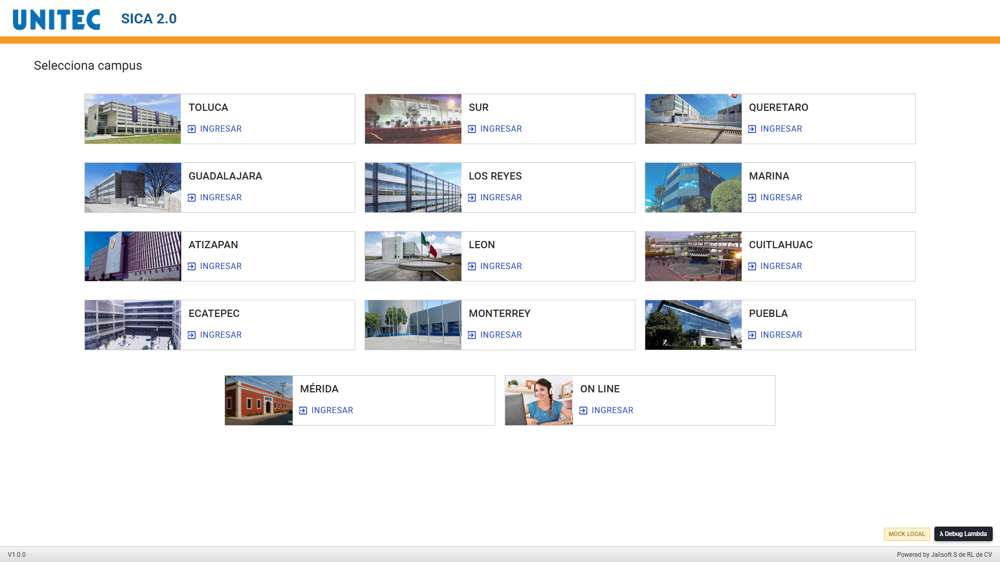
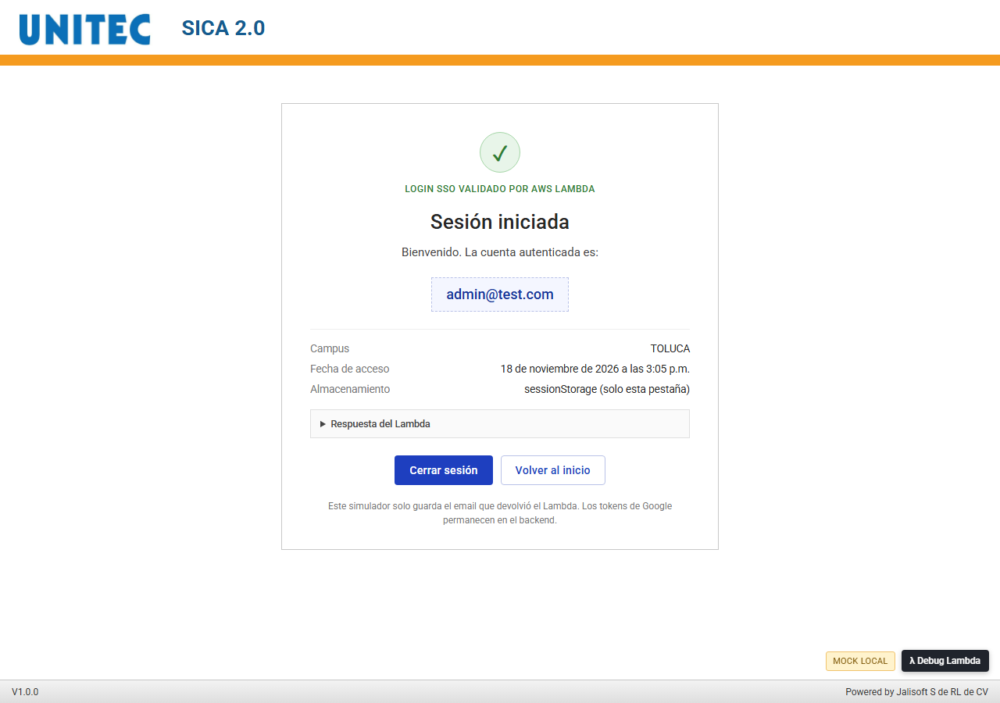
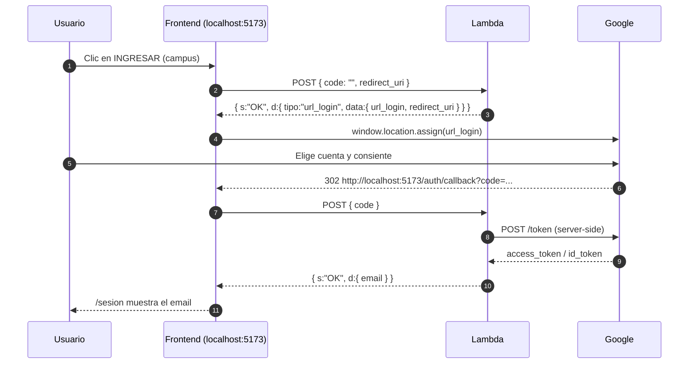

# SICA 2.0 · Simulador local de login SSO (Google + AWS Lambda)

Réplica local de la pantalla inicial de **SICA 2.0** (UNITEC) con el flujo de inicio de sesión
SSO de Google a través de un **web service Lambda**. Sirve para validar el backend real desde tu
máquina usando una **redirect URI local**, sin depender del sitio productivo.

La pantalla reproduce el `unitec_page.html` original: header con logo UNITEC + “SICA 2.0”, barra
naranja, grid de 14 campus con sus imágenes, botón **INGRESAR** por campus y footer
“V1.0.0 / Powered by Jalisoft S de RL de CV”. Los assets se descargaron y guardaron localmente en
`public/` para que el simulador no dependa de internet.



> Los distintivos flotantes `MOCK LOCAL` y `λ Debug Lambda` solo aparecen en desarrollo.

---

## Arranque rápido (todo simulado)

Requisitos: **Node.js 18+** (probado con Node 24) y npm.

```bash
npm install
```

En dos terminales:

```bash
# Terminal 1: mock del Lambda + pantalla de Google simulada
npm run mock

# Terminal 2: frontend Vite
npm run dev
```

En Windows también puedes levantarlos como procesos independientes (siguen corriendo aunque
cierres la terminal):

```powershell
powershell -ExecutionPolicy Bypass -File scripts/start-local.ps1
powershell -ExecutionPolicy Bypass -File scripts/stop-local.ps1
```

Los logs quedan en `logs/` (`mock.out.log`, `mock.err.log`, `vite.out.log`, `vite.err.log`).

Abre <http://localhost:5173> y prueba:

1. Clic en **INGRESAR** de cualquier campus.
2. El front llama al mock con `code=""` y recibe la `url_login`.
3. El navegador navega a una pantalla que imita el selector de cuentas de Google.
4. Clic en la cuenta `admin@test.com` (o en **Cancelar** para probar el error).
5. Google simulado redirige a `http://localhost:5173/auth/callback?code=...`.
6. El front manda ese `code` al mock y recibe `{ "d": { "email": "admin@test.com" } }`.
7. Se muestra la página **Sesión iniciada** con el email, mismo header y footer.



> El mock está en `mock/lambda-mock.mjs`, escucha en `http://localhost:4000` y no tiene
> dependencias externas.

Variables opcionales del mock:

| Variable | Default | Descripción |
| --- | --- | --- |
| `MOCK_PORT` | `4000` | Puerto del mock (si lo cambias, actualiza `VITE_LAMBDA_URL`). |
| `MOCK_REDIRECT_URI` | `http://localhost:5173/auth/callback` | URI usada si el front no envía `redirect_uri`. |
| `MOCK_EMAIL` | `admin@test.com` | Email que devuelve el paso 2. |
| `MOCK_DELAY_MS` | `650` | Retardo simulado del canje del código. |

---

## Conectar el Lambda real

Edita `.env` (o crea `.env.local`) y reinicia Vite:

```dotenv
VITE_LAMBDA_URL=https://TU-API-ID.execute-api.us-east-1.amazonaws.com/dev
VITE_LAMBDA_METHOD=POST
VITE_LAMBDA_BODY_FORMAT=json
VITE_LAMBDA_CODE_FIELD=code

VITE_LOCAL_REDIRECT_URI=http://localhost:5173/auth/callback
VITE_SEND_REDIRECT_URI=true
VITE_SEND_CAMPUS=false
VITE_SHOW_DEBUG=true
```

Cuando `VITE_LAMBDA_URL` está vacío **en desarrollo**, el front usa automáticamente
`http://localhost:4000/dev` y muestra el aviso `MOCK LOCAL`. En un build de producción sin URL,
el botón mostrará un error de configuración.

### Variables disponibles

| Variable | Default | Descripción |
| --- | --- | --- |
| `VITE_LAMBDA_URL` | vacío → mock | URL completa del endpoint del Lambda. |
| `VITE_LAMBDA_METHOD` | `POST` | `POST` o `GET`. |
| `VITE_LAMBDA_BODY_FORMAT` | `json` | Si es POST: `json` o `form` (x-www-form-urlencoded). |
| `VITE_LAMBDA_CODE_FIELD` | `code` | Nombre del parámetro del código de Google. |
| `VITE_LAMBDA_EXTRA_PARAMS` | `{}` | JSON con parámetros fijos extra (ej. `api_key`). |
| `VITE_LAMBDA_HEADERS` | `{}` | JSON con cabeceras extra (ej. `{"x-api-key":"..."}`). |
| `VITE_LAMBDA_TIMEOUT_MS` | `20000` | Timeout de cada petición. |
| `VITE_LOCAL_REDIRECT_URI` | `http://localhost:5173/auth/callback` | URI local que recibe el `code`. |
| `VITE_SEND_REDIRECT_URI` | `true` | Envía `redirect_uri` al Lambda para que genere la `url_login` local. |
| `VITE_SEND_CAMPUS` | `false` | Envía también `campus` (nombre del campus seleccionado). |
| `VITE_SHOW_DEBUG` | `true` | Consola flotante de depuración (solo en desarrollo). |

---

## Contrato esperado del Lambda

El front soporta el flujo de dos pasos que describiste.

### Paso 1 · Pedir la URL de Google (`code` vacío)

Petición (configuración por defecto: `POST` + JSON):

```http
POST https://tu-api/dev
Content-Type: application/json

{
  "code": "",
  "redirect_uri": "http://localhost:5173/auth/callback"
}
```

`redirect_uri` se omite si `VITE_SEND_REDIRECT_URI=false`. También puedes enviar `campus` con
`VITE_SEND_CAMPUS=true`.

Respuesta esperada:

```json
{
  "s": "OK",
  "d": {
    "tipo": "url_login",
    "data": {
      "url_login": "https://accounts.google.com/o/oauth2/v2/auth?client_id=...&redirect_uri=http%3A%2F%2Flocalhost%3A5173%2Fauth%2Fcallback&response_type=code&scope=openid+email+profile&access_type=offline&prompt=consent",
      "redirect_uri": "http://localhost:5173/auth/callback"
    }
  },
  "m": "url login generada correctamente"
}
```

El front valida `s === "OK"`, `d.tipo === "url_login"` y que `d.data.url_login` sea una URL
`http(s)` válida. Después hace `window.location.assign(url_login)`.

### Paso 2 · Canjear el código por el email

Después del consentimiento, Google (o el Lambda) redirige al navegador a la redirect URI local con
`?code=...`. El front captura el código y llama de nuevo al Lambda:

```http
POST https://tu-api/dev
Content-Type: application/json

{ "code": "4/0AVGzR1..." }
```

Respuesta esperada:

```json
{
  "s": "OK",
  "d": { "email": "admin@test.com" },
  "m": "Email obtenido correctamente"
}
```

Con `d.email` el front guarda la sesión simulada en `sessionStorage` y navega a `/sesion`.

### Variantes soportadas

- **GET**: los parámetros viajan en el query string
  (`GET /dev?code=...&redirect_uri=...`).
- **POST form**: `Content-Type: application/x-www-form-urlencoded`.
- El nombre del campo del código es configurable (`VITE_LAMBDA_CODE_FIELD`).
- Si el Lambda responde `s !== "OK"`, se muestra `m` como mensaje de error.
- Respuestas con HTTP 4xx/5xx, JSON inválido, CORS o timeout también se muestran con detalle
  técnico.

---

## Puntos críticos para la redirect URI local

Para que el `code` llegue a tu máquina, se deben alinear **tres** cosas:

1. **Google Cloud Console** → APIs & Services → Credentials → tu OAuth Client ID →
   *Authorized redirect URIs* debe incluir exactamente:

   ```
   http://localhost:5173/auth/callback
   ```

2. **El Lambda** debe generar `url_login` con ese mismo `redirect_uri`. Si el Lambda hoy usa
   `https://unitecsica.com/dev/`, necesitas:
   - que acepte el parámetro `redirect_uri` que envía este front (`VITE_SEND_REDIRECT_URI=true`),
     **o**
   - cambiar en el Lambda la URI configurada a `http://localhost:5173/auth/callback`.

3. **La URI debe coincidir carácter por carácter**: esquema, host, puerto, ruta y sin slash final
   adicional. `http://localhost:5173/auth/callback` y `http://127.0.0.1:5173/auth/callback` son
   distintas; registra ambas si vas a usar las dos.

Si Google muestra `Error 400: redirect_uri_mismatch`, el navegador nunca regresará a tu localhost:
el problema está en los puntos 1 y 2, no en el front.

> El Lambda sigue siendo el dueño del `client_secret` y del intercambio contra el endpoint de
> tokens de Google. Este frontend nunca ve ni maneja secretos.

### CORS en API Gateway

Como el front hace `fetch` desde `http://localhost:5173` hacia otro origen:

- Habilita CORS en el recurso (incluye el preflight `OPTIONS`).
- `Access-Control-Allow-Origin`: `http://localhost:5173` (o `*` en pruebas).
- `Access-Control-Allow-Headers`: al menos `Content-Type` (y `x-api-key` si usas
  `VITE_LAMBDA_HEADERS`).
- `Access-Control-Allow-Methods`: `GET,POST,OPTIONS`.

El mock local ya devuelve estas cabeceras.

---

## Cómo validar que el Lambda funciona

1. Primero valida el ciclo completo con `npm run mock` + `npm run dev`.
2. Configura `VITE_LAMBDA_URL` con el endpoint real y reinicia Vite.
3. Abre el botón flotante **λ Debug Lambda** (esquina inferior derecha) o DevTools → Network.
4. Pulsa **INGRESAR** y revisa:
   - Petición 1: `code: ""` → respuesta con `d.tipo: "url_login"`.
   - Redirección a `accounts.google.com`.
   - Regreso a `http://localhost:5173/auth/callback?code=...`.
   - Petición 2: `code` con valor → respuesta con `d.email`.
5. La consola de depuración guarda las peticiones en `sessionStorage`, por lo que **sobreviven a
   la redirección** del navegador y puedes ver ambos pasos juntos.

La página de callback también muestra los parámetros recibidos y la respuesta del Lambda en
“Detalles técnicos” cuando algo falla.

---

## Flujo completo



---

## Estructura del proyecto

```
front_project_simulator/
├─ index.html
├─ vite.config.ts
├─ .env / .env.example
├─ public/
│  ├─ logo.jpeg
│  └─ img/campus/*.jpg          # 14 imágenes localizadas
├─ src/
│  ├─ api/lambda.ts             # cliente del Lambda (2 pasos, GET/POST, errores, debug)
│  ├─ components/               # header, footer, tarjeta de campus, debug, copy
│  ├─ data/campuses.ts          # catálogo de campus
│  ├─ lib/session.ts            # pending login + sesión en sessionStorage
│  ├─ lib/debug.ts              # registro de peticiones/respuestas
│  ├─ pages/
│  │  ├─ HomePage.tsx           # pantalla inicial
│  │  ├─ CallbackPage.tsx       # captura del code y canje
│  │  ├─ SessionPage.tsx        # email autenticado
│  │  └─ NotFoundPage.tsx
│  ├─ styles/global.css
│  ├─ App.tsx                   # rutas + captura del code en cualquier ruta
│  └─ main.tsx
├─ mock/lambda-mock.mjs         # Lambda + Google simulados
├─ unitec_page.html             # HTML original de referencia
└─ README.md
```

### Rutas

| Ruta | Descripción |
| --- | --- |
| `/` | Pantalla de selección de campus. |
| `/auth/callback` | Recibe `code`/`error` y ejecuta el paso 2. |
| `/sesion` | Muestra el email autenticado y permite cerrar sesión. |

`App.tsx` incluye un capturador que redirige a `/auth/callback` si llega un `code` o `error` en
cualquier ruta (por ejemplo, si registras la redirect URI como `http://localhost:5173/` o
`http://localhost:5173/dev/`). Vite sirve `index.html` como fallback para esas rutas en desarrollo.

---

## Scripts

| Comando | Descripción |
| --- | --- |
| `npm run dev` | Frontend en <http://localhost:5173>. |
| `npm run mock` | Mock del Lambda en <http://localhost:4000>. |
| `npm run build` | Typecheck + build de producción en `dist/`. |
| `npm run preview` | Sirve el build en el puerto 5173. |
| `npm run typecheck` | Solo TypeScript. |

---

## Problemas comunes

| Síntoma | Causa probable | Solución |
| --- | --- | --- |
| `Error 400: redirect_uri_mismatch` | La URI no está registrada en Google o el Lambda genera otra. | Registra `VITE_LOCAL_REDIRECT_URI` en Google y haz que el Lambda use la misma. |
| Llega a `/auth/callback` pero sin `code` | Google regresó a otra URI o se canceló el consentimiento. | Revisa la barra de direcciones y los “Detalles técnicos”. |
| “No se pudo contactar al Lambda” | URL incorrecta, servicio caído o CORS. | Prueba el endpoint con `curl`; habilita CORS/OPTIONS en API Gateway. |
| HTTP 403/401 | El Lambda exige API key/authorization. | Usa `VITE_LAMBDA_HEADERS` (ej. `x-api-key`) o `VITE_LAMBDA_EXTRA_PARAMS`, o ajusta el backend. |
| HTTP 502/504 | Lambda con error o timeout. | Revisa CloudWatch; aumenta `VITE_LAMBDA_TIMEOUT_MS` si aplica. |
| `d.tipo` distinto de `url_login` | El Lambda devolvió otro contrato. | Ajusta el Lambda o el parseo en `src/api/lambda.ts`. |
| El segundo paso falla con código inválido | El `code` ya se usó o expiró. | Reinicia el flujo desde el campus; no recargues `/auth/callback`. |
| El email no aparece | La respuesta no trae `d.email`. | Verifica el JSON del paso 2 en la consola de depuración. |
| El mock no responde | No está corriendo o el puerto 4000 está ocupado. | Ejecuta `npm run mock`; cambia `MOCK_PORT` y `VITE_LAMBDA_URL`. |
| `Port 5173 is already in use` | `strictPort: true` evita que el puerto cambie y rompa la redirect URI. | Libera el puerto o cambia el puerto en `vite.config.ts`, `.env`, Google Console y el Lambda. |

---

## Notas de seguridad

- Este proyecto es un **simulador de desarrollo**. El mock imita a Google de forma explícita y no
  debe exponerse a internet.
- El `client_secret` de Google y los tokens deben permanecer en el Lambda. El frontend solo recibe
  el email.
- Los códigos de autorización de Google son de un solo uso. Por eso `main.tsx` no usa
  `StrictMode` (evita ejecutar dos veces el canje en desarrollo) y el callback protege contra
  ejecuciones duplicadas.
- La sesión simulada vive en `sessionStorage`: se borra al cerrar la pestaña y con **Cerrar
  sesión**.
- La consola de depuración solo se activa en desarrollo (`VITE_SHOW_DEBUG=true`). Guarda las
  peticiones/respuestas en `sessionStorage` (máximo 30, cuerpos truncados a 8 KB) y queda
  desactivada en el build de producción.
- Para producción, sirve el build con fallback SPA hacia `index.html` y registra la redirect URI
  HTTPS correspondiente.
